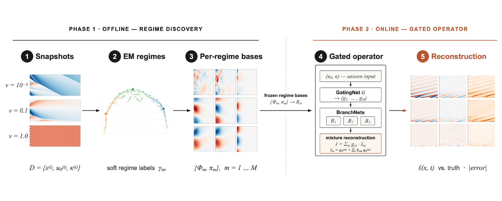

# TEMPO: Regime-Aware Operator Learning with Locally Adapted POD Bases

TEMPO learns local POD or NeuralPOD bases and combines their predictions
with an input-conditioned gate. Benchmarks: Burgers, Sod, Coanda, Darcy,
Navier–Stokes and heterogeneous Helmholtz.



## Install

```sh
python -m pip install -r requirements.txt
```

FNO uses `neuraloperator==2.0.0`; CNO source information is in
`paper/configs/dependencies.json`.

## Files

- `models/`: POD, NeuralPOD, TEMPO and joint neural-basis refinement.
- `scripts/`: data preparation, training and saved-model prediction.
- `utils/`: dataset loading and plotting utilities.
- `paper/`: settings, results, figures and prediction examples.
- `artifacts/`: model weights and their file index.
- `tests/`: checks for model loading and training components.

## Models

Weights and settings are indexed in `paper/configs/checkpoints.json`.
Unpack the model bundle from the repository root:

```sh
tar -xf artifacts/TEMPO-models.tar
```

Predict a Darcy pressure field:

```sh
python scripts/paper/replay_checkpoint.py \
  --checkpoint artifacts/checkpoints/darcy/tempo_pod2x32_seed17/checkpoint.pt \
  --inputs paper/examples/darcy_replay/input.npz --input-units raw --out output/darcy.npz
```

Input formats and units are described in [scripts/paper/README.md](scripts/paper/README.md).
Task settings are in `paper/configs/`; test errors and timings are in `paper/results/`.

## Figures and checks

```sh
python paper/figures/render_all.py --out output/figures
python -m unittest discover -s tests
```

The figure command builds all 14 article figures using the shared style.
Joint NeuralPOD refinement is implemented in `models/neural_refinement.py`;
settings are indexed in `paper/configs/refinement.json`.
